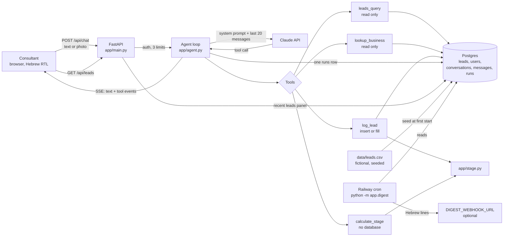

# Step 2: Architecture - AIDO Lead Copilot

The components, where each one runs, the data shapes, the limits, and every decision with its reason. What we build and why is in [01-design.md](01-design.md) and [spec.md](../spec.md). Keep this file current in the same PR as any change it describes.

This is the bakery-copilot architecture with the domain swapped. The layers, the agent loop, auth, limits, the digest and the hosting stay as they are; the data, the tools, the prompt and the UI change.

## Components and responsibilities

| Component | File(s) | Responsibility | Changes from bakery-copilot |
|---|---|---|---|
| Chat UI | `static/index.html`, `app.js`, `styles.css` | Login, chat with streaming, conversation list, a "recent leads" panel, a "fictional data" note | Hebrew, `dir="rtl"`, AIDO look; invoices panel becomes leads panel |
| API | `app/main.py` | Routes, auth check, SSE stream, `/health`, `/api/stats`, `/internal/digest` | `/api/invoices` becomes `/api/leads` |
| Agent loop | `app/agent.py` | Builds the system prompt, resends history, streams the model, runs tools, max 6 rounds, records one `runs` row | Prompt placeholders change (industries, data range); tool summaries for the new tools |
| System prompt | `app/prompts/system.md` | The assistant's job description | Rewritten: AIDO consultants, Hebrew first, numbers only from tools, no BI for כבאי |
| Stage calculator | `app/stage.py` (new) | Pure functions: stage for a total, stage for a domain average, score from 20 answers; `STAGE_HE` maps `firefighter`/`builder`/`inspector` to כבאי/בנאי/פקח, and tools return both, so the reply and the UI show Hebrew | New; a Python port of lesson 8 `src/score.js` |
| Tools | `app/tools/registry.py`, `app/tools/leads.py` (new) | Tool schemas the model sees, and the code that runs them | `sales_query` becomes `leads_query`; `lookup_supplier` becomes `lookup_business`; `log_invoice` becomes `log_lead`; new `calculate_stage` |
| Database | `app/db.py` | Tables, engine, seeding at start | `sales`, `suppliers`, `invoices` replaced by `leads`; schema version 2 |
| Data generator | `scripts/generate_leads.py` (new) | Seeded generator of the fictional dataset | New |
| Dataset | `data/leads.csv`, `data/README.md` (new) | The fictional leads, committed | Replaces `bakery_sales.csv` and `suppliers.csv` |
| Digest | `app/digest.py` | Morning lines, in Hebrew: new leads yesterday (`origin = chat`, created on the previous local `Asia/Jerusalem` day), hot leads waiting (all rows), spend | Rewritten queries |
| Auth, limits, costs, config | `app/auth.py`, `limits.py`, `costs.py`, `config.py` | Shared password + name cookie; 30/hour per user; $3/day cap; token prices | Unchanged |
| Tests | `tests/` | Deterministic parts, model mocked (pass/fail) | New tests for stage, leads tools, generator, digest |
| Evals | `evals/cases.yaml`, `evals/run.py`, `.github/workflows/ci.yml` | Real model answers scored against expectations (a pass rate) | New cases; `run.py` grades lead rows instead of invoices; a case can carry `must_pass: true` (every missing-score case does), and the run exits 1 if any of those fails, whatever the pass rate |
| Hosting | `.railway/railway.ts` | Web service, digest cron, Postgres on Railway | Repo source and project name change |

## Data flow

**Chat turn.** Unchanged from bakery-copilot: cookie checked, limits checked, user message saved, the system prompt (today's date, the data range and the list of industries, all read from the database) plus the last 20 messages go to the model, text streams back, tool calls run, at most 6 rounds, one assistant message and one `runs` row at the end.

**Logging a lead.** The photo travels in the same turn with an image reference string, as before. The model calls `lookup_business` first, then `log_lead` with `source_ref` set to the reference (or no reference for pasted text). The tool, not the prompt, enforces the rules below. The model never computes a stage.

## Data shapes

### `leads` table (also the CSV columns, minus the database-only ones)

| Column | Type | Notes |
|---|---|---|
| id | int | primary key |
| business_name | str(120) | as written |
| business_key | str(120), unique | normalised name, the dedup key. Order: lowercase; remove the legal suffixes first, in all their spellings (`בע"מ`, `בע״מ`, `בעמ`, `Ltd`, `Ltd.`); then remove punctuation; collapse spaces |
| industry | str(60) | from a fixed list in the generator; free text for new leads |
| employees | int, nullable | |
| lead_date | date | the day the lead came in |
| total_score | int, nullable | 20-60; null when missing or rejected |
| stage | str(12), nullable | `firefighter` / `builder` / `inspector`, computed by `app/stage.py` from `total_score` |
| strategy_avg, management_avg, systems_avg, people_avg, finance_avg | float, nullable | 1.0-3.0, one decimal |
| strategy_stage ... finance_stage | str(12), nullable | computed from each average |
| pains | text, nullable | main pains, `;`-separated |
| pipeline_status | str(12) | `new`, `contacted`, `meeting`, `diagnosed`, `proposal`, `won`, `lost` |
| deal_value | int, nullable | estimated, in ₪ |
| fictional | bool | true for every seeded row; false for rows logged through the chat |
| record_status | str(14) | `logged` or `needs_a_look` |
| source_ref | str(120), unique, nullable | image reference, when there was one |
| notes | text, nullable | including the reason for `needs_a_look` |
| origin | str(8) | `seed` or `chat` |
| logged_by | int, nullable | user id |
| created_at | datetime | when the row was written. The digest's "new yesterday" uses this **and** `origin = chat`, so seeded rows are never counted |

Hot = `deal_value >= 25000`. Waiting = `pipeline_status in (new, contacted)`. Both are computed in queries, not stored.

Tables `users`, `conversations`, `messages`, `runs` and `schema_version` stay as they are.

### Tools (inputs the model sends, outputs it gets)

- **`leads_query`** (read only): `metric` in `count`, `deal_value_sum`, `deal_value_avg`, `score_avg`; `group_by` in `none`, `stage`, `industry`, `pipeline_status`, `month`, `weakest_domain`, or a domain's stage (`strategy_stage` ... `finance_stage`); filters `date_from`, `date_to`, `stage`, `industry` (substring), `pipeline_status`, `hot_only`, `waiting_only`, `diagnosed_only`, `min_employees`, `max_employees`; `top_n`. Returns `{metric, group_by, filters, value}` or `{..., rows: [{key, value, count}], row_count}`. With `list: true` it returns up to `top_n` matching leads (name, industry, stage, status, deal value), so the model can name them.
- **`lookup_business`** (read only): `name` (partial). Matches on `business_key`, then on any word longer than 2 letters. Returns `{matches: [{id, business_name, industry, stage, total_score, pipeline_status, lead_date}], known: bool}`.
- **`log_lead`**: `business_name` (required), `industry`, `employees`, `lead_date`, `total_score` or `answers` (all 20, by domain), `domain_averages`, `pains`, `pipeline_status`, `deal_value`, `source_ref`, `notes`. Returns `{action: created | filled | duplicate, record_status, row}`.
- **`calculate_stage`** (no database): `total_score`, or `domain_averages`, or `answers`. Returns the stage(s) with the boundaries used.

### Rules `log_lead` enforces (from the design's "כללי רישום")

1. **Domain averages are optional.** A valid total with no averages is `logged`, and the five domain stages stay empty.
2. **The score** is `total_score` as given, or the sum of `answers` when all 20 are given (then the five domain averages are also computed from them). It is never derived from domain averages and never guessed. Partial answers are not a score: they are kept in the note, and the row counts as having no score.
3. **Conflict:** a `total_score` that differs from the sum of 20 given `answers` stores neither; `needs_a_look`, with the note "total and answers disagree".
4. **Out of range** (a score not 20-60, an average not 1.0-3.0, an answer not 1, 2 or 3; the design's "ציון מחוץ לטווח" applied to each part): that value is not stored, `record_status = needs_a_look`, and the note says why.
5. **Missing score:** the row is stored with `total_score` and `stage` null and `record_status = needs_a_look`.
6. **Duplicate:** the same `source_ref` or the same `business_key` is the same business. If the existing row has no score, any valid diagnosis fields in the call (score, averages) fill the **empty** fields only (`action: filled`); `record_status` becomes `logged` only once the row has a score. If the existing row already has a score, or the call brings nothing new for an empty field, it is `action: duplicate` and nothing changes. Nothing is ever overwritten.
7. **Stages** always come from `app/stage.py`. Domain averages are rounded to one decimal before comparing with 1.7 and 2.4.

## Model

`claude-opus-5-5`, effort `medium`, max 2,048 output tokens, prompt caching on the system prompt and the tools. Set by `MODEL` and `MODEL_EFFORT` in Variables, as before. Changing either, or the prompt or a tool, requires an eval run before and after.

## Limits

| Layer | Number | Where |
|---|---|---|
| Users | 30 messages per user per hour; images 5 MB or less | `app/limits.py` |
| Model | SDK retries on 429/529 (2) | Anthropic client |
| Money | $3.00 per local day | `app/limits.py`, from `runs` |
| Tool loop | 6 rounds per turn; tool results cut at 12,000 chars | `app/agent.py` |

## Hosting

One Railway project, as in bakery-copilot: the **web** service (Railpack, from `requirements.txt` and `.python-version`), the **Postgres** plugin, and the **digest** cron service (`python -m app.digest`, `30 4 * * *` UTC). They are all described in `.railway/railway.ts`, which now points at `ozt5002-stack/aido-lead-copilot`. Schema version 2 needs a fresh database: `init_db` only writes `schema_version` into an empty table, so a database left over from bakery-copilot is not upgraded. This project starts with a new Postgres.

## Secrets

 `ANTHROPIC_API_KEY`, `APP_PASSWORD`, `APP_SECRET`, `CRON_SECRET`, `DATABASE_URL`, optionally `DIGEST_WEBHOOK_URL`. They go in a gitignored `.env` locally and in Railway Variables. Oz enters them himself; they never go in chat or Git.

## Tests and evals

- **Tests** (pytest, model mocked, run in CI on every PR): stage boundaries (33/34, 46/47, 1.6/1.7, 2.3/2.4, rounding), the port matching `score.js` on the lesson 8 examples (the outputs of `score.js` are committed as `tests/fixtures/score_js_cases.json`, so CI does not need the lesson 8 folder), `leads_query` aggregates on a small fixture, `lookup_business` normalisation, every `log_lead` rule above, the generator being deterministic for a fixed seed and in range, the digest lines, including that seeded rows are not counted as new.
- **Evals** (`python -m evals.run`, real model, scored as a pass rate, run on prompt, tool or model changes and before release, and in CI when the `ANTHROPIC_API_KEY` secret is set): cases for each tool, duplicates, the fill-in, missing and out-of-range scores, no BI for כבאי, Hebrew replies, refusing deletes, no number without a tool. Baseline 80%, plus every `must_pass` case (all missing-score cases) must pass; CI runs `python -m evals.run --baseline 0.8`, which enforces both.

## Decisions

| Date | Decision | Reason | Would change it if |
|---|---|---|---|
| 2026-11-08 | Keep bakery-copilot's structure and history; swap only the domain | The assignment is to make the course project our own; keeping the history credits the source and shows what changed | The structure cannot express a requirement |
| 2026-11-08 | One `leads` table holds both the lead and its diagnosis | A diagnosis belongs to one business; one row keeps dedup and queries simple | A business needs several diagnoses over time (then add a `diagnoses` table) |
| 2026-11-08 | Stage computed in `app/stage.py`, never by the model | The boundaries are rules, not judgement; code is testable and cannot drift | Never: this is the core rule |
| 2026-11-08 | Expose the stage calculator as a fourth tool, `calculate_stage` | Consultants ask "what stage is 41?"; answering from the model would break "numbers only from tools" | The tool is never called in real use |
| 2026-11-08 | Dedup by normalised business name, plus `source_ref` | No external id exists for a small business; the brief asks that no business is added twice | Two real businesses share a name (then add city or phone to the key) |
| 2026-11-08 | Filling an empty diagnosis is allowed; overwriting is not | A lead usually arrives before its diagnosis; refusing would force a second row or manual edits, and overwriting would lose data | Consultants need to correct scores (then add an audited edit) |
| 2026-11-08 | Structured `leads_query`, no SQL from the model | Least access, as in bakery-copilot: the model cannot read or change anything else | Ad-hoc analysis the parameters cannot express |
| 2026-11-08 | Dataset generated by a committed, seeded script | Same file every run, reviewable, clearly fictional; no real client data in a public repo | Real data is ever used (then it must not be in the repo) |
| 2026-11-08 | Drop the bakery tables and start at schema version 2 with `create_all` | There is no production data yet, so nothing to migrate | The first schema change after real data exists (then add Alembic) |
| 2026-11-08 | Hebrew, right-to-left UI and Hebrew-first prompt | The consultants work in Hebrew; the stage names are Hebrew | An English-speaking team joins |
| 2026-11-08 | Public GitHub repo | The lecturer must see it; there are no secrets in the code and the data is fictional | Real client data or configuration has to be committed |

Decisions inherited from bakery-copilot and still valid, copied with their original dates and reasons:

| Date | Decision | Reason | Would change it if |
|---|---|---|---|
| 2026-10-17 | One service serves UI and API | Ten users; a CDN or a second service is cost and a second deploy for nothing | Traffic from the public web, or a separate frontend team |
| 2026-10-17 | Postgres over Airtable | Chat history grows fast; Airtable's record cap and rate limit would be hit within weeks | Non-developers must edit rows by hand daily |
| 2026-10-17 | Images not stored | Cheaper, smaller database, fewer privacy questions; the row is the record | A requirement to show the original invoice later |
| 2026-10-17 | Shared password + typed name, not accounts | One business, ten people, no admin; per-user limits still work | A second client, or a client who wants per-person access control |
| 2026-10-17 | Digest as a Railway cron service, not an external pinger | Same repo, same variables, runs for seconds, costs cents | Railway removes cron, or the digest needs to run in several regions |
| 2026-10-27 | Railpack build, no Dockerfile | The Dockerfile only pinned Python and ran pip; Railway's default builder does the same from `requirements.txt` and `.python-version`, one file less to keep current | A system package (apt) or a multi-stage build is needed, or Railway drops Railpack |
| 2026-10-27 | Infrastructure as Code (`.railway/railway.ts`) instead of `railway.json` | Railway deprecated config-as-code files (they stop working on 2026-12-01); one IaC file describes both services, so the cron service needs no config path of its own | Railway changes the IaC format again, or a setting the DSL cannot express |
| 2026-11-04 | Chat history is resent as text only; the system prompt says earlier replies were tool-checked and must not be re-checked or retracted unasked | The first live chats showed the model, seeing its old figures without the tool calls behind them, re-running tools on unrelated turns and telling users their searches "never ran" (issue #2). A prompt rule fixes it with no schema change | The eval `no_recheck_after_off_topic` regresses → store a compact tool trace per message and replay it (a schema change, so add Alembic first) |
